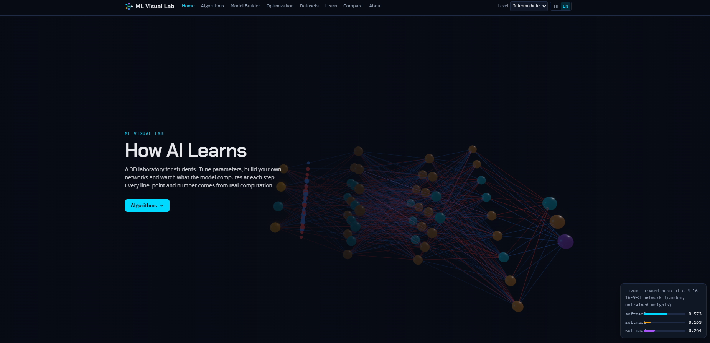
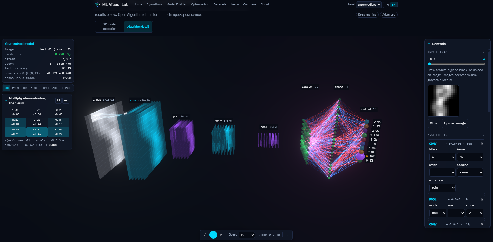

# ML-12-Application II 

ML Visual Lab is an interactive web app for learning machine learning and deep learning through 3D simulations. Students can adjust algorithm parameters, build neural networks, train supported models, inspect intermediate calculations, and compare experimental results. The interface supports Thai and English. Computation runs locally in the browser.

## Tech Stack


React Three Fiber, Drei, and React Three Postprocessing provide the 3D rendering layer. Zustand manages application state, React Router handles navigation, Framer Motion provides animation, Plotly.js displays charts, and KaTeX renders equations.

## Web Application Preview

The home page introduces the application with an interactive 3D neural network and navigation to the learning labs.



### CNN Lab

The CNN lab displays the input image, convolution and pooling feature maps, dense layers, and output probabilities for digits 0–9. Controls allow students to edit the architecture, train the model, draw or upload an image, and inspect calculations.



Metrics in the screenshot describe that particular experiment and vary with the model, input, and training settings.

## Supported Algorithms and Labs

| Area | Algorithms / models | Main features |
| --- | --- | --- |
| Classification and regression | KNN, SVM, Linear Regression, Logistic Regression | Distances, votes, kernels, margins, residuals, and decision boundaries |
| Clustering | K-Means, DBSCAN | Cluster updates, neighborhoods, core/border/noise points |
| Tree models | Decision Tree, Random Forest | Tree growth, decision paths, bootstrap, and feature importance |
| Optimization | Gradient Descent | Loss surfaces and optimizer trajectory comparison |
| Neural networks | MLP, CNN | Architecture editing, training, activations, weights, and feature maps |
| Sequence models | RNN, LSTM | Unrolled networks, recurrent states, gates, and gradient inspection |
| Attention | Transformer | Multi-head attention, Q/K/V inspection, and attention heatmaps |
| Vision architectures | VGG16, ResNet50, DenseNet121, InceptionV3, MobileNetV2, ViT | Compact executable teaching models and full-architecture references |

The Algorithms gallery contains 20 runnable algorithm/model labs. Additional pages provide a Dataset Explorer, Model Comparison, and 21 lessons with quizzes and selectable learning levels.

## Installation

Run the following PowerShell commands from the project root. Install Node.js with npm first. The pinned Vite version supports Node.js `^18.0.0 || ^20.0.0 || >=22.0.0`. The browser must support WebGL.

### 1. Check Node.js and npm

```powershell
node --version
npm --version
```

### 2. Install Dependencies

```powershell
npm ci
```

### 3. Run the App

Double-click **`ML_App.bat`** in the project folder to start the application. It installs dependencies if Vite is missing, starts the server, and opens the web app in your browser automatically.

You can also launch it from PowerShell:

```powershell
.\ML_App.bat
```

Node.js and npm must already be installed and available in PATH. The pinned Vite version supports Node.js `^18.0.0 || ^20.0.0 || >=22.0.0`. Use a browser with WebGL support; an internet connection is needed when installing dependencies.

Keep the launcher window open while using the app. Press `Ctrl+C` in that window to stop the server. If the browser does not open, use the URL printed in the terminal, normally [http://127.0.0.1:5173](http://127.0.0.1:5173). No API key or separate database is required.

## Production Build

```powershell
npm run build
npm run preview
```

Publish the contents of `dist/` to a static host. The application uses hash-based routes, such as `/#/algorithms/knn`.

For GitHub Pages hosted under a repository path, build with a relative asset base:

```powershell
npm run build -- --base=./
```

Configure the hosting workflow to publish the resulting `dist/` contents. Keep both preview images in the repository root so the README image links display correctly on GitHub


